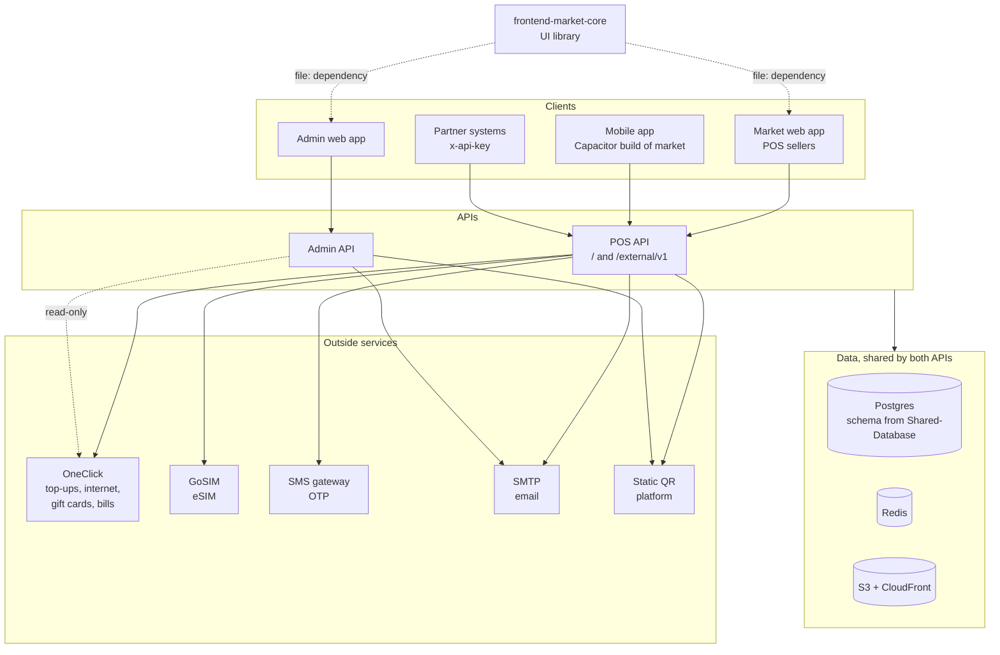

Mizaniya Pay is two NestJS APIs, two React web apps and one database schema, spread over six repositories.

## The pieces

Both APIs share **one** Postgres database. Neither API calls the other: the admin side changes rows the POS side reads.

## Repositories

| Repository | What it is | Stack |
| --- | --- | --- |
| `Mizaniya-Pay-POS-Backend` | POS API, including the partner API under `/external/v1` | NestJS 11, TypeORM, Postgres, Redis |
| `Mizaniya-Pay-Admin-POS-Backend` | Admin API: accounts, permissions, prices, commissions, partner keys | NestJS 11, TypeORM, Postgres, Redis |
| `Mizaniya-Pay-POS-Shared-Database` | TypeORM entities, enums and migrations used by both APIs | TypeScript, consumed as a git submodule |
| `mizaniya-pay-frontend-market` | Web app for POS sellers, and the source of the mobile app | React 19, Vite 7, Tailwind 4, Capacitor 6 |
| `mizaniya-pay-frontend-market-admin` | Web app for the admin team | React 19, Vite 7, Tailwind 4 |
| `mizaniya-pay-frontend-market-core` | Shared UI components and theme | React 19 library |

**The shared database is not an npm package.** Each backend checks it out as a submodule and compiles it in through the `@shared-db/*` path alias. See [Shared database](/backend/shared-database).

**The core library is a `file:` dependency.** Both web apps expect it in a sibling folder named `mizaniya-pay-frontend-market-core`.

## The POS API

- **Who calls it:** the market web app, the mobile app, and partners.
- **Two surfaces:** the routes at `/` use a bearer token (`access-token`). The partner API at `/external/v1` uses the `x-api-key` header. See [POS backend](/backend/pos).
- **Outside services:**

| Service | Used for | Client in the code |
| --- | --- | --- |
| OneClick | Mobile top-ups (Djezzy, Ooredoo, Mobilis), Algérie Télécom internet, gift cards, bill payments | `src/common/oneclick/oneclick.client.ts` |
| GoSIM | eSIM packages | `src/gosim/gosim-api.client.ts` |
| SMS gateway | Phone codes (OTP) | `src/common/sms/sms.service.ts` |
| SMTP | Approval, password and eSIM emails | `src/common/emailer/` |
| Static QR platform | Setting amounts on a seller's QR code (V-TPE) | `src/common/static-qr/static-qr.client.ts` |
| S3 + CloudFront | Uploaded ID cards and public files | `src/attachment/attachment.service.ts` |

<Note>
  On `staging`, **Ooredoo goes through OneClick** like the other operators. A direct Ooredoo link exists only on the unmerged branches `feat/ooredoo-direct` and `feat/deferred-ooredoo-direct`.
</Note>

## The admin API

- **Who calls it:** the admin web app only.
- **Auth:** bearer token (`access-token`), then a second factor by email code.
- **Permissions:** every route is checked against the admin's access type. See [Permissions](/backend/permissions).
- **Outside services:** SMTP (login codes, password resets), S3 (attachments), the static QR platform, and OneClick **read-only**: the gift card list and each card's stock, when an admin presses the update button (`src/common/oneclick/oneclick.client.ts`). Only the POS backend sells through OneClick.

## Background jobs

Both APIs register `ScheduleModule`, so every `@Cron` in them runs inside the API process. There is no separate worker.

| API | Job | Schedule | File |
| --- | --- | --- | --- |
| POS | Marketplace order poller | Every 30 s | `src/marketplace/marketplace.poller.ts` |
| POS | Admin actions on orders | Every 5 s | `src/marketplace/order-admin-action.processor.ts` |
| POS | V-TPE payments poller | Every 5 s | `src/marketplace/vtpe-payments.poller.ts` |
| POS | Bill V-TPE payments | Every 5 s | `src/bills/bills-vtpe.service.ts` |
| POS | Provider balance poller | Every 10 min | `src/marketplace/provider-balance.poller.ts` |
| POS | Gift card catalog refresh | Hourly | `src/gift-cards/gift-catalog.cache.ts` |
| POS | Catalog margin sync | Daily, 04:00 | `src/marketplace/catalog-margin-sync.service.ts` |
| POS | Partner API request retention | Daily, 03:00 | `src/partner-api-tracking/partner-api-request.retention.ts` |
| POS | OTP clean-up | Daily, 02:00 | `src/auth/otp/otp.service.ts` |
| POS | Token-key rotation and clean-up | Hourly, daily, weekly, monthly | `src/common/token-keys/token-keys.service.ts` |
| Admin | Expiry of admin reset keys | Daily, 01:00 | `src/common/token-keys/token-keys.service.ts` |

**Run one instance of each API**, or a job runs once per instance.

## API docs routes

Each API serves its own reference:

| Route | What |
| --- | --- |
| `/api` | Swagger UI |
| `/api-json` | OpenAPI JSON |
| `/reference` | Scalar |

In `production` these routes ask for a basic-auth login (`SWAGGER_USER`, `SWAGGER_PASS`). In any other environment they are open.

The **POS API** and **Admin API** tabs of this site are built from the same OpenAPI documents. Each backend exports its own with `npm run openapi:export`, on the `chore/openapi-export` branch until that is merged.

## Deployment (staging)

Every push to `staging` in an app repository runs its `staging.yml` workflow:

<Steps>
  <Step title="Build">
    The workflow builds a Docker image from `deploy/staging/Dockerfile`. A backend checks out the shared database at the commit it pins. A web app checks out the core library from its `staging` branch.
  </Step>
  <Step title="Push">
    The image goes to GHCR as `ghcr.io/evolvit-tech/<repository>:staging` and `:<commit>`.
  </Step>
  <Step title="Restart">
    Over SSH, the VPS pulls the image in `/opt/mizaniya-staging` and restarts the service with `docker compose`.
  </Step>
</Steps>

| Repository | Compose service | Extra step |
| --- | --- | --- |
| `Mizaniya-Pay-POS-Backend` | `pos` | Runs the migrations before the restart |
| `Mizaniya-Pay-Admin-POS-Backend` | `admin` | None |
| `mizaniya-pay-frontend-market` | `web-market` | None |
| `mizaniya-pay-frontend-market-admin` | `web-admin` | None |

**Migrations run only from the POS deploy.** A migration added for the admin side reaches the database on the next POS deploy.

The web apps get their API address at build time (`VITE_API_URL` build argument), so changing an API host means rebuilding the web app.

<Warning>
  Older workflows are still in the repositories: `deploy.yml` (POS, push to `dev`), `deploy-staging.yml` (admin API, market web app, shared database) and `deploy-stating.yml` (admin web app). Ask the tech lead which flow production uses before relying on them.
</Warning>
